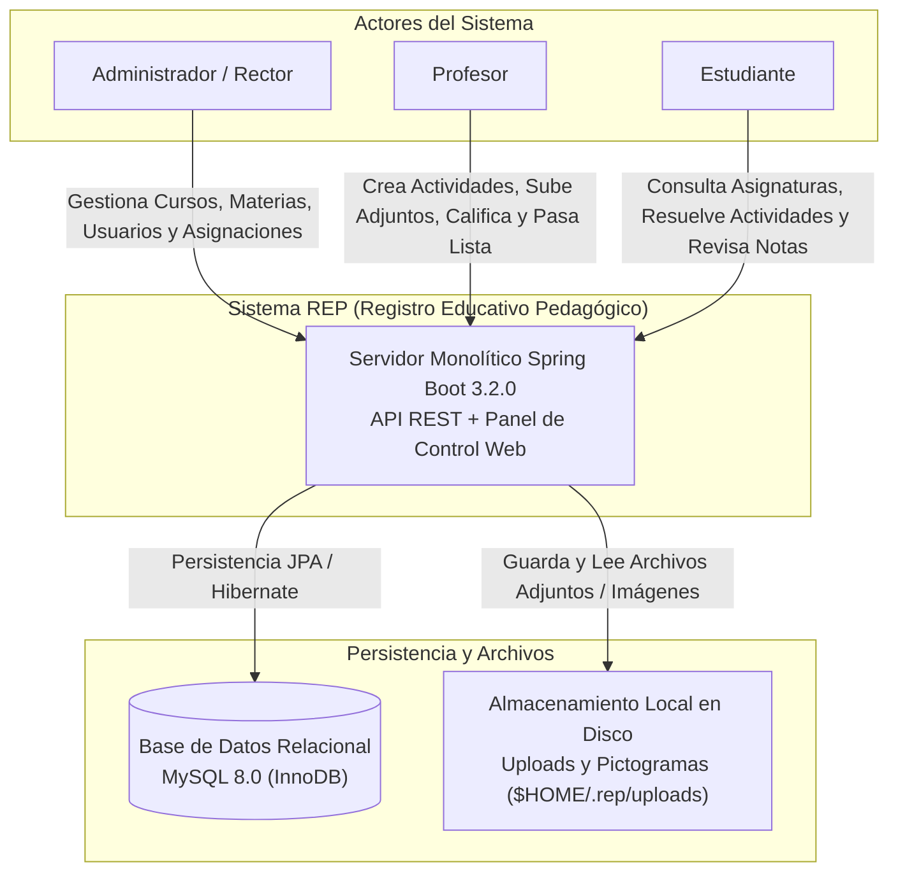
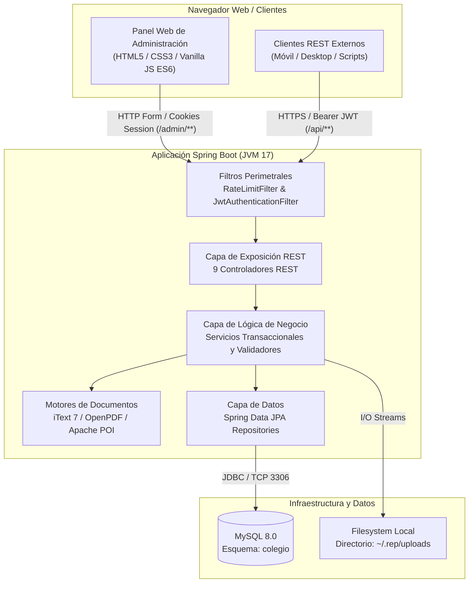
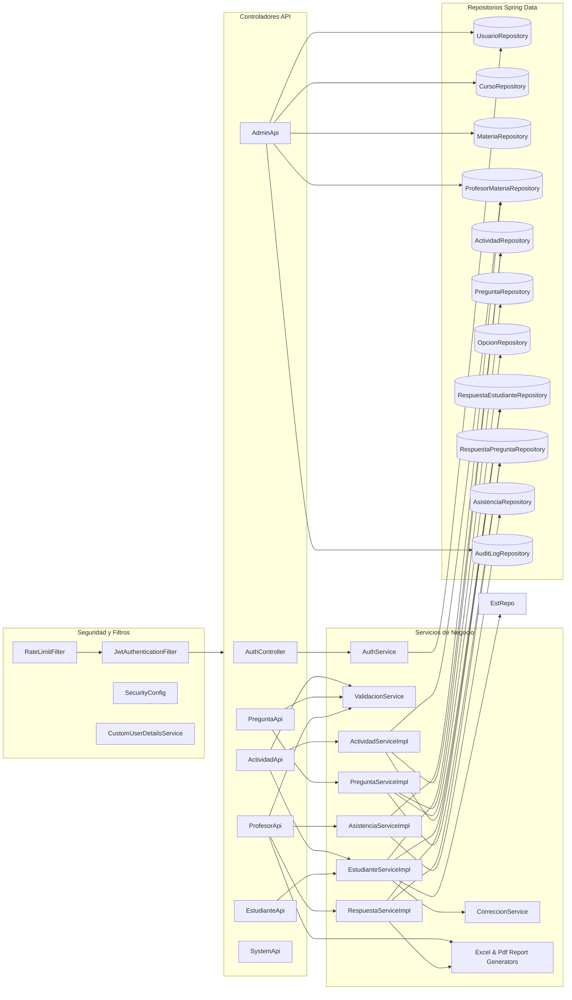
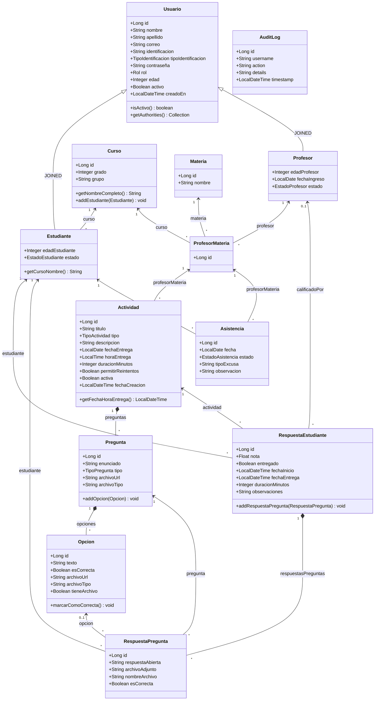
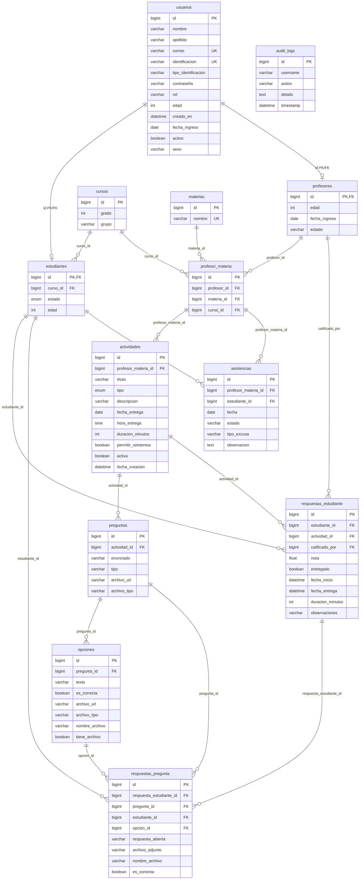
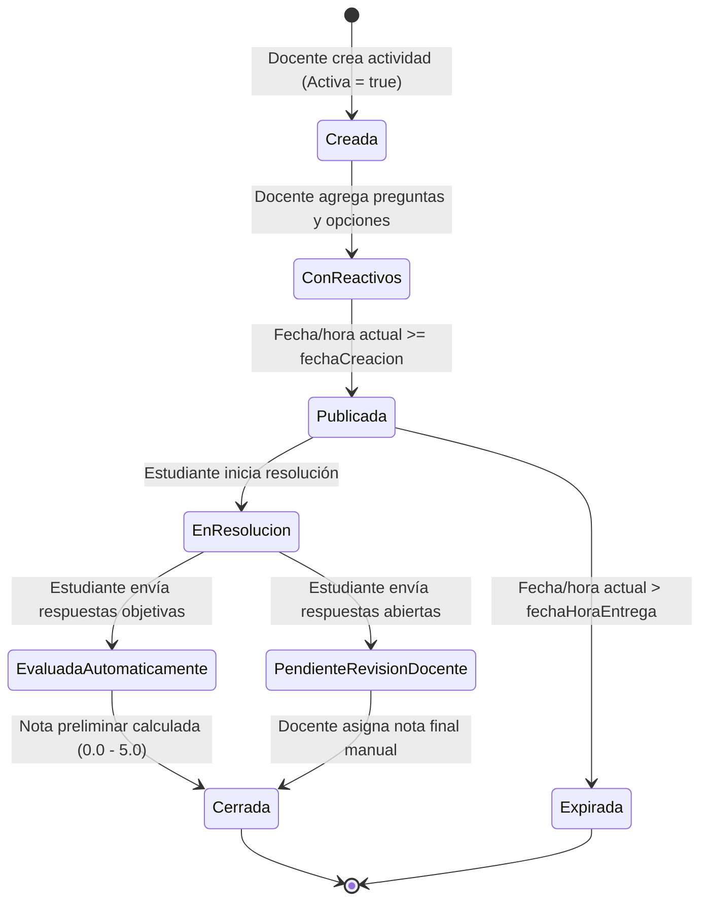

# 📊 Diagramas Arquitectónicos del Sistema REP

Este documento reúne las representaciones visuales del sistema utilizando diagramas formales en estándar Mermaid, reflejando fielmente la estructura del código y el modelo de datos real.

---

## 1. Diagrama de Contexto del Sistema (C4 - Nivel 1)

---

## 2. Diagrama de Contenedores (C4 - Nivel 2)

---

## 3. Diagrama de Componentes del Backend (C4 - Nivel 3)

---

## 4. Diagrama de Clases del Dominio Principal (UML)

---

## 5. Diagrama Entidad-Relación de Base de Datos (ERD)

---

## 6. Diagrama de Estado: Ciclo de Vida de una Actividad y Entrega

