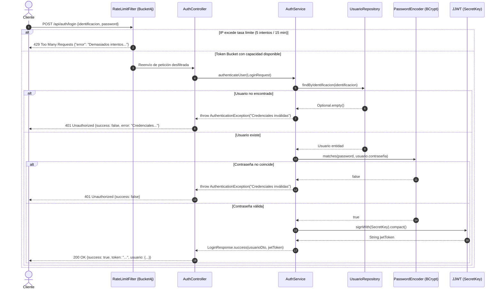
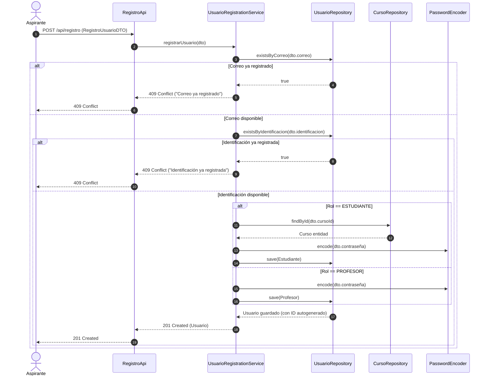
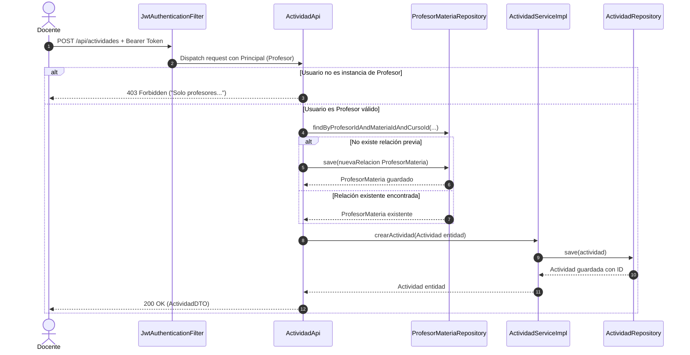
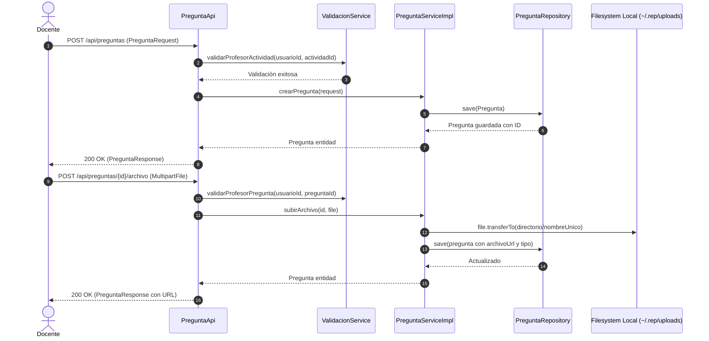
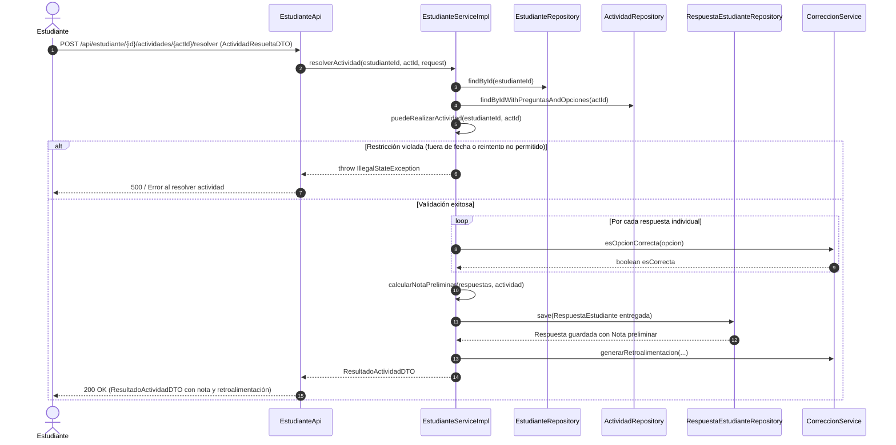

# 🔄 Flujos de Negocio y Ejecución del Sistema REP

Este documento reconstruye con máxima precisión técnica los siete flujos operativos fundamentales del sistema, detallando los actores involucrados, componentes intervinientes, transformaciones de datos, persistencia en base de datos, respuestas HTTP y control de excepciones, acompañados de diagramas de secuencia Mermaid.

---

## Flujo 1: Autenticación de Usuario y Emisión de Token JWT

### 1.1 Ficha Técnica del Flujo
- **Disparador:** El cliente (usuario) envía sus credenciales (`identificacion` y `password`) a través de una petición HTTP `POST /api/auth/login`.
- **Componente Receptor:** `RateLimitFilter` -> `AuthController`.
- **Servicios Involucrados:** `RateLimitFilter`, `AuthService`, `UsuarioRepository`, `PasswordEncoder`, `SecretKey`.
- **Datos Transformados:** `LoginRequest` (JSON) -> `Usuario` (Entidad) -> `AuthUsuarioDTO` y Token JWT (String criptográfico firmado) -> `LoginResponse` (JSON).
- **Persistencia / Consulta:** Consulta lectura a la tabla `usuarios` por `identificacion`.
- **Respuesta Exitosa:** `200 OK` con `LoginResponse(success=true, token="ey...", usuario=AuthUsuarioDTO)`.
- **Manejo de Errores:**
  - Si la IP excede 5 intentos en 15 minutos: `429 TOO MANY REQUESTS` retornado por `RateLimitFilter`.
  - Si la identificación no existe o la contraseña no coincide con el hash BCrypt: `401 UNAUTHORIZED` con `LoginResponse.error("Credenciales inválidas")`.
  - Si `usuario.isActivo() == false`: `401 UNAUTHORIZED` con `LoginResponse.error("Cuenta inactiva")`.

### 1.2 Diagrama de Secuencia

---

## Flujo 2: Auto-Registro de Nuevo Usuario

### 2.1 Ficha Técnica del Flujo
- **Disparador:** Un usuario o estudiante envía su información personal a `POST /api/registro`.
- **Componente Receptor:** `RegistroApi`.
- **Servicios Involucrados:** `UsuarioRegistrationService`, `UsuarioRepository`, `CursoRepository`, `PasswordEncoder`.
- **Operaciones:** Validación de unicidad de correo e identificación, validación de campos obligatorios según el rol (si es `ESTUDIANTE`, la edad y el `cursoId` son obligatorios), codificación de contraseña con BCrypt, y persistencia polimórfica en las tablas `usuarios` y `estudiantes`/`profesores`.
- **Respuesta Exitosa:** `201 CREATED` con la entidad de usuario serializada en JSON.
- **Manejo de Errores:**
  - Si el correo o identificación ya existen: `409 CONFLICT` con mensaje `"El correo electrónico ya está registrado"` o `"La identificación ya está registrada"`.
  - Si los datos son inválidos o el curso no existe: `400 BAD REQUEST`.

### 2.2 Diagrama de Secuencia

---

## Flujo 3: Creación de Actividad Evaluativa por el Docente

### 3.1 Ficha Técnica del Flujo
- **Disparador:** Docente autenticado envía `POST /api/actividades` con cabecera `Authorization: Bearer <token>` y cuerpo `ActividadCreateDTO`.
- **Componente Receptor:** `JwtAuthenticationFilter` -> `ActividadApi`.
- **Servicios Involucrados:** `ProfesorMateriaRepository`, `ActividadService`, `ActividadRepository`.
- **Operaciones:**
  1. Valida que el `@AuthenticationPrincipal Usuario` sea de tipo `Profesor`.
  2. Valida los campos de `ActividadCreateDTO` (`duracionMinutos > 0`, `fechaEntrega >= LocalDate.now()`).
  3. Consulta o inicializa la asociación en `ProfesorMateria` para la tríada `(profesor.id, materiaId, cursoId)`.
  4. Crea la entidad `Actividad` vinculando `ProfesorMateria`, `fechaCreacion = now()`, `activa = true`, `permitirReintentos = false`.
  5. Persiste en base de datos y mapea a `ActividadDTO`.
- **Respuesta Exitosa:** `200 OK` con `ActividadDTO` en JSON.
- **Manejo de Errores:**
  - Si el usuario no es `Profesor`: `403 FORBIDDEN`.
  - Si faltan campos o fechas pasadas: `400 BAD REQUEST`.
  - Si falla la base de datos: `500 INTERNAL SERVER ERROR`.

### 3.2 Diagrama de Secuencia

---

## Flujo 4: Adición de Reactivos y Archivos Adjuntos a una Actividad

### 4.1 Ficha Técnica del Flujo
- **Disparador:** Docente envía `POST /api/preguntas` para crear un reactivo, y subsecuentemente `POST /api/preguntas/{id}/archivo` con un archivo multipart.
- **Componentes:** `PreguntaApi`, `ValidacionService`, `PreguntaServiceImpl`, `PreguntaRepository`, `OpcionRepository`.
- **Operaciones:**
  1. `ValidacionService` comprueba que la actividad asociada pertenezca al docente autenticado.
  2. Si la pregunta es de opción múltiple, se verifica que haya exactamente 1 opción correcta y como máximo 5 opciones.
  3. Al subir el archivo, el servicio crea el directorio `$HOME/.rep/uploads/` si no existe, transfiere físicamente el archivo con un timestamp prefijado y actualiza `archivoUrl` y `archivoTipo`.
- **Respuesta Exitosa:** `200 OK` con `PreguntaResponse`.
- **Manejo de Errores:**
  - Si el profesor no posee la actividad: `403 FORBIDDEN`.
  - Si se envían 0 o >1 opciones correctas: `400 BAD REQUEST` (`ValidacionException`).
  - Si el archivo excede los 10MB: `413 PAYLOAD TOO LARGE` capturado por `GlobalExceptionHandler`.

### 4.2 Diagrama de Secuencia

---

## Flujo 5: Consulta y Resolución de Actividad por el Estudiante

### 5.1 Ficha Técnica del Flujo
- **Disparador:** Estudiante autenticado envía `POST /api/estudiante/{id}/actividades/{actividadId}/resolver` con `ActividadResueltaDTO`.
- **Componentes:** `EstudianteApi`, `EstudianteServiceImpl`, `CorreccionService`, `RespuestaEstudianteRepository`.
- **Operaciones:**
  1. Ejecución de `puedeRealizarActividad`: verifica curso coincidente, ventana de tiempo (`fechaCreacion <= now <= fechaHoraEntrega`), estado activo e intentos previos.
  2. Búsqueda o inicialización de la entidad `RespuestaEstudiante`.
  3. Iteración sobre cada reactivo: si es de opción múltiple/VF, se compara la opción elegida contra la opción correcta asignando `esCorrecta = true/false`. Si es respuesta abierta, se almacena el texto y `esCorrecta = null`.
  4. Invocación de `calcularNotaPreliminar`: cálculo ponderado en escala 0.0 a 5.0 sobre las preguntas objetivas.
  5. Persistencia de `RespuestaEstudiante` con `entregado = true` y `fechaEntrega = now()`.
  6. Conversión a `ResultadoActividadDTO` con retroalimentación textual reactivo por reactivo.
- **Respuesta Exitosa:** `200 OK` con `ResultadoActividadDTO`.
- **Manejo de Errores:**
  - Si el estudiante no pertenece al curso o la fecha expiró: `500` o `400` con `IllegalStateException("El estudiante no puede realizar esta actividad")`.
  - Si no existe la actividad o el estudiante: `404 NOT FOUND`.

### 5.2 Diagrama de Secuencia

---

## Flujo 6: Calificación Manual Docente y Consulta de Resultados

### 6.1 Ficha Técnica del Flujo
- **Disparador:** Docente consulta la lista de entregas de su actividad (`GET /api/actividades/{id}/resultados`), examina una respuesta abierta y asigna o ajusta la calificación final (`PUT /api/actividades/{id}/notas/{estudianteId}?nota=4.5&observaciones=Excelente`).
- **Componentes:** `ActividadApi`, `ValidacionService`, `ActividadServiceImpl`, `RespuestaEstudianteRepository`.
- **Operaciones:**
  1. `ValidacionService.validarProfesorActividad` asegura que la actividad pertenezca a la carga docente.
  2. Se localiza `RespuestaEstudiante` por `(estudianteId, actividadId)`.
  3. Se sobreescribe el campo `nota` y se registran las `observaciones`.
  4. Se guarda en base de datos y se retorna la entidad actualizada.
- **Respuesta Exitosa:** `200 OK` con la entidad `RespuestaEstudiante`.
- **Manejo de Errores:**
  - Si la actividad no pertenece al docente: `403 FORBIDDEN`.
  - Si la respuesta del estudiante no existe: `404 NOT FOUND` (`RecursoNoEncontradoException`).

---

## Flujo 7: Pase de Lista Diario y Exportación de Asistencia / Reportes

### 7.1 Ficha Técnica del Flujo
- **Disparador:** Docente registra la asistencia de una sesión (`POST /api/profesor/asistencia?cursoId=1&materiaId=2&fecha=2026-11-11`) o solicita la descarga de un reporte ejecutivo (`GET /api/profesor/reportes/resultados/export?cursoId=1&actividadId=5&formato=pdf`).
- **Componentes:** `ProfesorApi`, `ValidacionService`, `AsistenciaServiceImpl`, `RespuestaServiceImpl`, `PdfReportGenerator`, `ExcelReportGenerator`.
- **Operaciones:**
  1. Validación de jurisdicción con `validarProfesorCursoMateria`.
  2. Para asistencia: búsqueda o creación de tuplas `Asistencia(fecha, estudiante, profesorMateria, estado)`.
  3. Para reportes: consulta de respuestas, compilación binaria con iText 7 (`.pdf`) o Apache POI (`.xlsx`), e inyección de la cabecera `Content-Disposition: attachment; filename=resultados.<formato>`.
- **Respuesta Exitosa:** `200 OK` con array de bytes binarios.
- **Manejo de Errores:**
  - Si el profesor no imparte esa materia en ese curso: `403 FORBIDDEN`.
  - Si se solicita un formato no reconocido (distinto de "pdf" o "xlsx"): `400 BAD REQUEST` (`IllegalArgumentException`).
